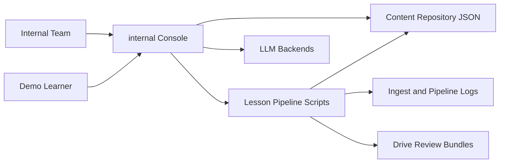
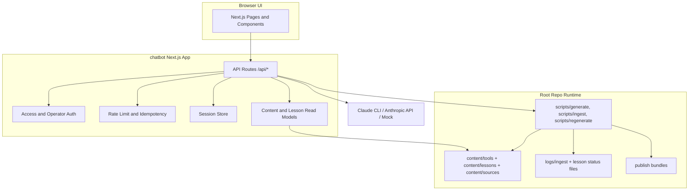
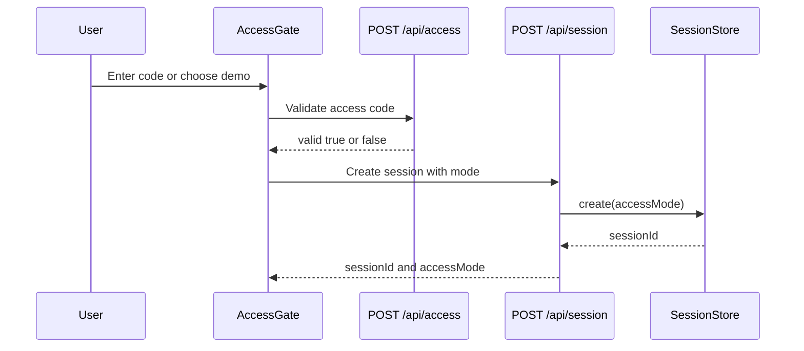
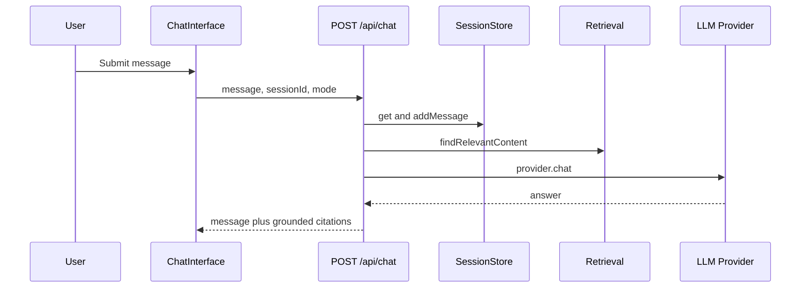
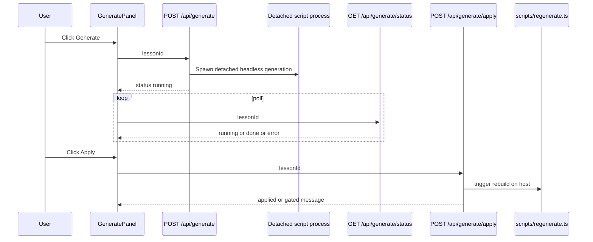
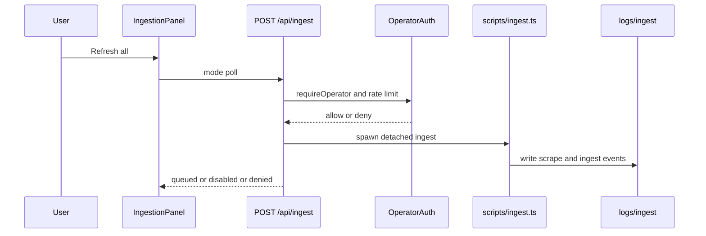

# Architecture + Feature Map (Issue #69)

Updated: 2026-05-28  
Repo commit: `37f12b9`  
GitNexus status: indexed and up to date at `37f12b9` (`gitnexus status`).

This is the canonical walkthrough map for the internal demo: what exists, how it connects, and what "working" means per page.

## C4 Context

## C4 Container

## Sequence: Auth (Access + Session)

## Sequence: Chat

## Sequence: Generate

## Sequence: Ingestion

## Per-Page Feature Contract

| Page | Purpose | Data Inputs | Routes Used | Working Means | Status |
|---|---|---|---|---|---|
| `/` | Internal console home and launchpad | lesson directory stats | none | Hub links load and metrics render from live lesson state | Working |
| `/chat` | Tutor chat entry | access mode and session | `/api/access`, `/api/session`, `/api/chat` | valid session creation, answers returned, citations shown, mode toggle works | Working |
| `/content` | Tool repository browsing | `content/tools/*.json` | none | list and detail views load all tools with filters | Working |
| `/content/compare` | Side-by-side tool comparison | `content/tools/*.json`, benchmark data | none | selected tools compare with benchmark/source sections | Working |
| `/ingestion` | Freshness and manual trigger | ingest logs + ingest config | `/api/ingest` | latest run, freshness states, trigger response surfaced | Working (host trigger gated) |
| `/studio/generate` | Draft script and apply flow | lesson outline summary + draft files | `/api/generate`, `/api/generate/status`, `/api/generate/cancel`, `/api/generate/apply` | generation starts, survives navigation via status polling, cancel works, apply gives honest host gate | Working |
| `/studio/menu` | Lesson directory for planning | lesson metadata from content folder | none | lessons list with title, duration, stale/draft flags | Working |
| `/studio` | Timeline review and comment/edit control plane | lesson timeline, comments, edits | `/api/comments`, `/api/edits`, `/api/edits/apply`, `/api/regen` | timeline and inspector load, comments persist, edits apply path responds | Partially Working (video pane and full rebuild UX still limited) |
| `/marketing` | Public-facing marketing surface | static content | none | hero and feature sections render; links into product surfaces | Working |

## GitNexus Reconciliation

This map was reconciled against current GitNexus symbol/process context at commit `37f12b9`.

| Flow | GitNexus Evidence | Reconciled Result |
|---|---|---|
| Chat | `context POST --file chatbot/src/app/api/chat/route.ts` shows calls to `requireRateLimit`, `findRelevantContent`, `getLLMProvider`, `parseCitations`, `keepGroundedCitations` | Sequence includes rate limit, retrieval, provider call, grounded citations |
| Generate | `context POST --file chatbot/src/app/api/generate/route.ts` shows `requireOperator`, `readIdempotentReplay`, `writeIdempotentResult`, status helpers | Sequence includes operator gate, idempotency, detached background job, status polling |
| Ingest | `context POST --file chatbot/src/app/api/ingest/route.ts` shows `requireOperator`, idempotency helpers, `buildIngestArgs` | Sequence includes operator auth + rate limit, detached ingest spawn, runtime log output |
| Auth boundary | `context requireOperator --file chatbot/src/lib/operator-auth.ts` shows inbound write routes and outbound `requireRateLimit` + `isOperatorAuthorized` | Auth section reflects deny-by-default operator routes with rate limiting |
| Access gate | `context POST --file chatbot/src/app/api/access/route.ts` shows `validateAccessCode` + `requireRateLimit` | Auth sequence and page contract reflect access validation and throttling |

Notes:
- GitNexus process names are currently generic (for example, many `POST -> ...` labels), so symbol context was used as the primary reconciliation signal.
- If process labels need business-level names for leadership artifacts, rename/mapping should be done in a follow-up graph curation pass.
