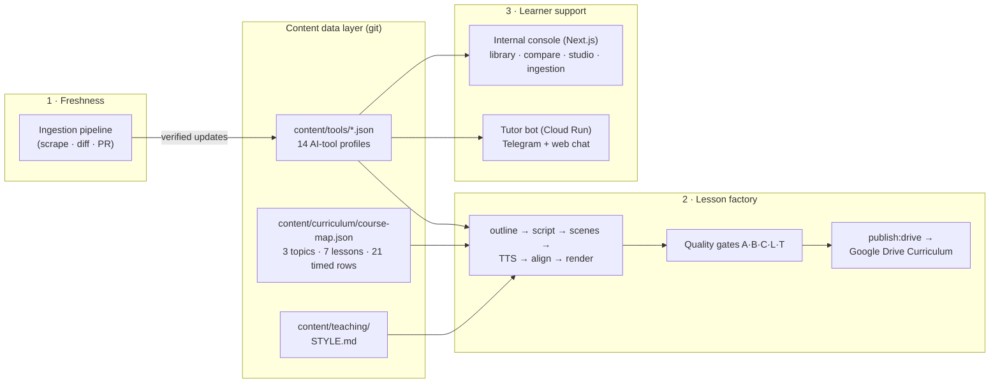

# Sample Academy — AI Content System

A content production and maintenance system for **Sample Academy**, an AI education platform for
working professionals. The system turns a
course outline into **fully animated, narrated video lessons**, keeps the course's tool facts
current as AI vendors ship changes, and provides learner support — all with minimal human
intervention.

**The north star:** run the asynchronous side of the course with minimal human intervention.
The system does the work; humans approve the diff.


> Live status: GitHub issues.
> **Status:** the sample lessons are gate-green (A·B·C·L·T) and the word-budget system enforces lesson length
> at three layers.

---

## How the platform works

Three subsystems share one data layer:



1. **Freshness** — vendor docs are scraped, diffed against the tool profiles, and proposed as
   reviewable changes. Tool facts in lessons and chat always trace to an official source.
2. **The lesson factory** — the core of the system. The course outline is compiled into a
   versioned course map; each lesson is authored as *data* (outline + script JSON), rendered to a
   narrated 1080p MP4 by Remotion, and blocked from publishing until five automated quality gates
   pass. Lessons are **100% animation** (Anthropic-video-style stylized screens — no recordings;
   real footage is a contained future swap via the scene-type seam).
3. **Learner support** — the same curated tool data grounds an internal operations console and
   the student-facing Tutor assistant, so answers cite course content instead of LLM memory.

---

## Technical architecture

### Repository layout

| Path | What lives there |
|---|---|
| `content/tools/` | The 14 tool profiles (Zod-validated JSON; capabilities, tiers, sources) |
| `content/curriculum/` | `course-map.json` (compiled from Instructor's outline DOCX) + `delivery-types.json` |
| `content/teaching/` | `STYLE.md` (voice contract distilled from workshop transcripts) |
| `content/lessons/<id>/` | One lesson = data: `outline.json`, `script.json`, `lesson.json`, `lesson-plan.md`, `evidence.md`, `assumptions.md`, audio/align artifacts, `review/` gate verdicts |
| `content/schemas/` | Zod schemas for every artifact (scene types, lesson, outline, script) |
| `src/compositions/` | Remotion: `LessonVideo.tsx` (data-driven renderer) + `lesson-scenes/` (17 scene components) + `brand/tokens.ts` |
| `src/lib/` | Pipeline logic: regen DAG, gates, word budget, TTS adapter, course-map compiler |
| `scripts/` | CLI entry points (`generate-script`, `regenerate`, `gate:*`, `publish:drive`, …) |
| `chatbot/` | The internal console (Next.js 16 App Router) |
| `bot/` | The standalone student-facing Tutor bot (Node, Cloud Run) |
| `.claude/skills/` | Authoring skills (lesson-plan, animated-lesson, watch) — the codified editorial process |
| `.planning/` | Canonical state, curriculum planning, research, verification artifacts |

### The lesson pipeline (a lesson is data, video is a build artifact)

```
course-map.json ──► lesson-plan.md ──► outline.json + script.json ──► lesson.json ──► MP4
   (compiler)        (the journey)        (beats + narration)          (scenes)      (render)
```

| Stage | Tool | What happens |
|---|---|---|
| **Compile** | `npm run compile:course-map` | Instructor's outline DOCX → versioned `course-map.json` (topic → lesson → timed row, delivery-typed). The outline is the only scope authority. |
| **Plan** | `lesson-plan` skill | A learner-journey plan: a beat table with per-beat word budgets. Scope, pedagogy, facts, examples and voice inputs are kept separate so they do not cross-contaminate. |
| **Script** | `npx tsx scripts/generate-script.ts <id>` | Emits a generation prompt embedding the **word budget** (outline minutes × 60 × 2.96 w/s × 0.85 — the measured TTS pace) and the grounding facts. `--check` then fact-checks every tool claim against `content/tools/` **and fails scripts under the length floor in seconds** — before any render. |
| **Scenes** | `plan-lesson` (inside regenerate) | `script.json` → `lesson.json`: one validated scene per beat, dispatched by `sceneType` to the 17 components. |
| **Voice** | Kokoro-82M TTS (Docker sidecar) | Per-scene WAVs — free, local, no API key. |
| **Align** | stable-ts forced alignment | Word-level timings measured from the real audio. **Timing inversion:** narration length drives scene duration, never hand-authored frames. |
| **Render** | Remotion + headless Chrome | 1080p/30fps H.264 MP4 with word-synced captions. Per-lesson props injection. |
| **Regenerate** | `npx tsx scripts/regenerate.ts <id>` | Content-hashed DAG (`plan → tts:<scene> → align → render`): edit one scene's narration and only that scene re-synthesizes. Two-pass node build (plan runs first) so narration and scene-set edits are correct in a single pass. |

### The quality gate system (Definition of Done = A·B·C·L·T)

A lesson cannot reach Drive until `npm run gate:status -- <id>` exits 0 — all five gates green.
Deterministic sensors gather evidence; a headless Claude judge rules; the orchestrating session
supplies live web verification and adjudicates with sources on record.

| Gate | Name | What it checks | How |
|---|---|---|---|
| **A** | Fidelity · Provenance · Freshness | Every claim maps to an outline row; every tool fact traces to an official source, live-verified | Headless judge + live web adjudication (`gate:review <id> A`) |
| **B** | Teaching axis | Does it *teach*? Judged against the lesson plan | Headless judge vs the lesson plan (`gate:review <id> B`) |
| **C** | Watch gate | A judge *watches the actual MP4*: render breakage, garbled/hallucinated on-screen text, brand, signposts | Frame extraction + judge (`gate:lesson <id> --auto`) + out-of-band audio probe |
| **L** | Layout integrity | No clipped text, no text-on-text overlap, safe-area compliance — measured, not eyeballed | `LayoutProbe` mounts in Remotion's real DOM and emits `getBoundingClientRect` for every element (`gate:layout <id>`) |
| **T** | Timing integrity | Rendered duration is 75–120% of the outline's minutes for that lesson | ffprobe vs `course-map.json` (`gate:timing <id>`) |

The same word-count constraint exists at **three layers** (generation prompt → `--check`
pre-flight → Gate T), so a too-short script fails in seconds instead of after a 30-minute render.

### The scene system (why the videos look the way they do)

- **17 data-driven scene types** (`cover`, `journey-map`, `feature-grid`, `capability-table`,
  `comparison-chats`, `tool-demo`, `screen-flow`, `quote-card`, `audit-quadrant`, …), each a
  React component fed validated `content` from `lesson.json`. Adding course content never means
  writing React; it means writing JSON.
- **Demos are animated tool simulations**, not screen recordings: `screen-flow` renders a generic
  window with a spring-physics cursor (glide → dwell → click pulse), character-streamed typing,
  and staged UI reveals — the Anthropic-YouTube visual register, honest by design ("stylized
  simulation, not a real screenshot").
- **Brand is enforced in code:** `brand/tokens.ts` carries the Syne/#EDE8E3/#8B2635/4px system
  plus leading/spacing/safe-area scales every scene inherits; motion is spring-only (no cuts);
  an optional per-scene Ken Burns `zoom` adds camera motion within schema-bounded limits.

### The console (`chatbot/`, Next.js — internal operations)

`/` team home · `/content` tool library with freshness badges · `/content/compare` benchmarked
comparison · `/chat` Ask-Tutor (RAG over the tool data, Claude SDK) · `/studio` lesson directory
with live A·B·C·L·T gate badges and a publish-blocked pill · `/lessons` playback ·
`/ingestion` per-vendor freshness control panel · `/marketing` public landing (separate surface).
Dev server runs on **:3100**.

### The Tutor bot (`bot/` — student-facing, Cloud Run)

A small standalone Node service (no Next.js dependency) sharing only the `content/tools` data:
keyword retrieval → persona prompt → LLM provider (`mock` for tests, Gemini free-tier for the
pilot) → **citation hallucination guard** (drops any source the model fabricates). Channels:
Telegram (webhook on Cloud Run, long-poll locally) + a web test page + `POST /chat`. Hardened
for production: IP-keyed rate limiting, a global daily request cap (spend circuit breaker),
Telegram chat allowlist, prompt-injection fencing of retrieved content, structured access logs.
Deploy runbook: `bot/README.md`.

### Freshness / ingestion

Scrapers (robots.txt-compliant) poll vendor docs on a weekly cron, diff against
`content/tools/*.json`, and stage changes for review — schema-gated writes, per-vendor branches.
The curated freshness layer records live-verified facts with
URLs and dates; Gate A re-verifies at lesson build time. Claims policy: **official sources only**
— confirmed → used; unverifiable → softened or dropped.

### Delivery

Videos never enter git (too big). `npm run publish:drive -- <id>` copies the gate-green Video +
Lesson Plan + Script reference into the shared Google Drive `Curriculum/Module N/Lesson N.M`
folder — and refuses unless all five gates are green. Drive is the exec/Instructor handoff surface;
Teachable upload is manual from there.

### Engineering discipline

- **TDD enforced mechanically:** a Stop-hook script (`.claude/hooks/stop-gate.py`, wired in via `.claude/settings.json` when enabled) blocks a working
  session from ending unless typecheck + lint + tests pass on the changed slice; CI re-runs
  everything plus full builds on push.
- **Container-first:** Docker from day 1 (render + TTS sidecars); Windows/macOS/cloud portable.
- **Prove, don't trust:** every gate writes a human-readable verdict artifact into
  `content/lessons/<id>/review/`; verification evidence lives in `.planning/verification/`.
- **Knowledge stack:** `learnings.md` (working memory) → `wiki/` (curated) → GitNexus index
  (code-graph for impact analysis).

---

## Tech stack

| Layer | Choice |
|---|---|
| Video | Remotion v4 (React → 1080p MP4), FFmpeg |
| Voice | Kokoro-82M TTS (local Docker sidecar) + stable-ts forced alignment |
| Web console | Next.js 16 (App Router), TypeScript, Tailwind CSS 4 |
| Student bot | Node 22 + plain `http`, Google Cloud Run (scale-to-zero), Telegram Bot API |
| AI backends | Claude (console RAG + headless gate judges), Gemini free tier (bot pilot) |
| Data & validation | JSON-as-content, Zod 4 schemas everywhere |
| Ingestion | Cheerio, robots-parser, p-limit |
| Testing | Vitest (602 root · 274 chatbot · 39 bot) + Playwright E2E, GitHub Actions CI |
| Containers | Docker (node:22-bookworm-slim) |
| Brand | Syne font, #EDE8E3 base, #8B2635 accent, 4px radius — enforced via `brand/tokens.ts` |

## Running locally

```bash
# Internal console (port 3100 — :3000 is reserved by another project)
cd chatbot && npm install && npm run dev -- -p 3100

# Build a lesson end-to-end (after editing outline.json / script.json)
npx tsx scripts/generate-script.ts <lessonId> --check   # fact-check + length pre-flight
npx tsx scripts/regenerate.ts <lessonId>                # plan → TTS → align → render

# Quality gates
npm run gate:layout -- <lessonId>     # L: DOM-measured layout
npm run gate:timing -- <lessonId>     # T: duration vs outline minutes
npm run gate:lesson -- <lessonId> --auto      # C: watch the MP4
npm run gate:review -- <lessonId> A --auto    # A: fact-check (judge)
npm run gate:review -- <lessonId> B --auto    # B: teaching axis (judge)
npm run gate:status -- <lessonId>     # all five — exit 0 = publishable

# Deliver (refuses unless gates are green; set DRIVE_CURRICULUM_DIR)
npm run publish:drive -- <lessonId>

# Content ingestion
npm run ingest:poll

# Tutor bot (local, no keys needed in mock mode)
cd bot && npm install && npm test && npm start   # http://localhost:3100
```

Environment keys: see `bot/.env.example` (bot) and `chatbot/.env.example` (console). Gemini
quotas are per Google Cloud project, not per key.

---

---

