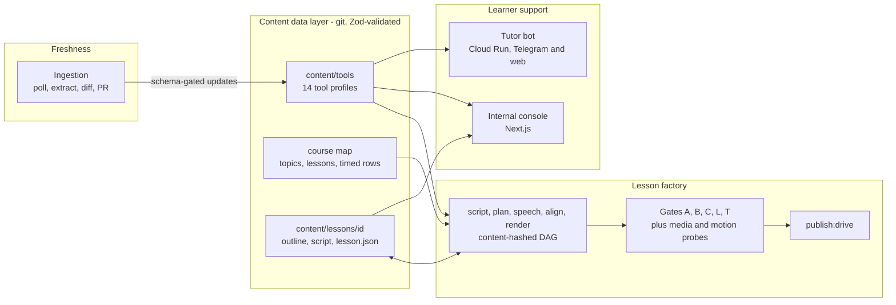

# Agentic Video Lesson Studio + Chatbot

A set of AI agents that plan, script, build and review narrated, animated 1080p video lessons, plus a tutor
chatbot that answers questions from the same curated data. Lessons are validated data and videos are build
artifacts, so changing one sentence re-synthesizes one scene instead of re-producing a video, and agents
plus deterministic gates decide whether a render may ship.

Built by [BTECHK](https://github.com/BTECHK).

**The problem.** Courses about AI tools go stale within weeks, and video is the most expensive format to
correct: re-record, re-edit, re-time, re-check. This project replaces that loop with a content-hashed
build, and replaces "looks fine to me" with machine-readable verdicts that a script can refuse to
publish past.

> **About this repository.** This is a sanitized public copy of a private project. The git history is the real
> history, with original timestamps preserved and commit messages rewritten to remove private details; about
> a quarter of commits have empty diffs because the files they touched were excluded. Course content, brand
> assets and business materials are replaced by clearly synthetic sample content (a fictional "Sample Academy"
> and a seven-lesson sample course), and rendered videos and audio are not included. The engineering is
> unchanged and is the point of this repository. One consequence: the gates report the sample lessons as
> "not run" and the corpus ledger reports them as not green, which is the correct answer.
> [Running it locally](#running-it-locally) separates the commands that were verified on this copy from the
> ones that need Docker, FFmpeg or a logged-in `claude` CLI.

**At a glance:** about 38.5k lines of TypeScript, TSX and Node scripts across three packages, 915 passing
tests, 18 scene types, five artifact gates plus media and motion probes, and 455 commits over roughly twelve
weeks. The repository-level numbers are reproduced in [Project stats](#project-stats) with the command that
produced them.

**Where to look first**

| If you care about | Read |
|---|---|
| The agents and what keeps them honest | [The agents](#the-agents) |
| The shape of the system | [`docs/ARCHITECTURE.md`](docs/ARCHITECTURE.md): context, containers, components, two sequence diagrams |
| Why it is built this way | [`docs/decisions/INDEX.md`](docs/decisions/INDEX.md): seven decision records with evidence and costs |
| Incremental rebuilds | [`src/lib/build-dag.ts`](src/lib/build-dag.ts), [`src/lib/regen-graph.ts`](src/lib/regen-graph.ts) |
| Quality gates | [`src/lib/gate-status.ts`](src/lib/gate-status.ts), [`src/lib/gate-layout.ts`](src/lib/gate-layout.ts), [`src/lib/claude-judge.ts`](src/lib/claude-judge.ts) |
| A hardened public service | [`bot/`](bot/) (908 lines, no third-party runtime imports) |
| How AI-assisted work was kept honest | [`docs/ACCEPTANCE.md`](docs/ACCEPTANCE.md), [`agent-ops/AGENT_PLAYBOOK.md`](agent-ops/AGENT_PLAYBOOK.md) |

## The agents

| Agent | What it does | What keeps it honest | Code |
|---|---|---|---|
| **Lesson planner** | A Claude Code skill that turns an outline entry into a lesson plan: a learner-journey cascade and a beat table with a word budget per beat | Scope comes only from the outline; the plan is reviewed before any script exists | [`.claude/skills/lesson-plan/`](.claude/skills/lesson-plan/SKILL.md) |
| **Script writer** | A headless `claude -p` run drafts narration from the outline and only the tool facts the lesson references, and writes it as a draft for review | Output must parse as `ScriptSchema`, every tool claim is fact-checked against the tool profiles, and a word-budget pre-flight fails short scripts in seconds | [`generate-script-headless.ts`](scripts/generate-script-headless.ts), [`script-prompt.ts`](src/lib/script-prompt.ts), [`fact-check.ts`](src/lib/fact-check.ts) |
| **Review judges** | Headless Claude judges check facts against official sources (Gate A), teaching quality against the plan (Gate B), and the finished MP4 from extracted frames (Gate C) | Deterministic sensors gather the evidence; a strict parser reads the verdict file; a missing or malformed verdict fails closed | [`claude-judge.ts`](src/lib/claude-judge.ts), [`gate-review.ts`](src/lib/gate-review.ts), [`gate-lesson.ts`](src/lib/gate-lesson.ts) |
| **Edit agent** | Turns a reviewer's comment on a clip into an edit of `script.json`; the content-hashed build then re-renders only what changed | The model call is injected, so the orchestration is unit-tested without a live model | [`ai-regen.ts`](src/lib/ai-regen.ts), [`regen-graph.ts`](src/lib/regen-graph.ts) |
| **Freshness agent** | Polls vendor documentation, extracts changes (scraper or Claude-assisted prompt), diffs them against the tool profiles, and opens one pull request per vendor | Every write is schema-validated; unknown fields are set aside; a human merges the pull request | [`ingest.ts`](scripts/ingest.ts), [`llm-extract.ts`](scripts/ingest/llm-extract.ts), [`differ.ts`](scripts/ingest/differ.ts), [`pr-workflow.ts`](scripts/ingest/pr-workflow.ts) |
| **Tutor chatbot** | Answers learner questions grounded in the tool profiles, in a web console and as a standalone Telegram and web bot | Sources are derived from the retrieved data, so a citation the model invents is dropped; retrieved text is fenced as untrusted; rate limits and a daily spend cap | [`chat/route.ts`](chatbot/src/app/api/chat/route.ts), [`citations.ts`](chatbot/src/lib/citations.ts), [`bot/src/brain.ts`](bot/src/brain.ts) |
| **Autonomous build loop** | A watchdog keeps a headless Claude Code session working toward a written goal and restarts it on hangs or crashes; a second model family (Codex) reviews at gates | A stop hook blocks a session from finishing while typecheck, lint or tests fail; "done" needs evidence, not assertion | [`overnight-supervisor.sh`](agent-ops/overnight-supervisor.sh), [`AGENT_PLAYBOOK.md`](agent-ops/AGENT_PLAYBOOK.md), [`AGENTS.md`](AGENTS.md), [`stop-gate.py`](.claude/hooks/stop-gate.py) |

---

## Architecture at a glance



Three subsystems share one data layer. The full C4-style breakdown, with code links, is in
[`docs/ARCHITECTURE.md`](docs/ARCHITECTURE.md).

## The lesson pipeline

A lesson is a directory of files. Each stage reads validated input and writes validated output.

```
course-outline.txt -> course-map.json -> outline.json -> script.json -> lesson.json -> WAV + timings -> MP4
```

| Stage | Command | What happens |
|---|---|---|
| Compile the course map | `npm run compile:course-map` | The committed outline text becomes a versioned `course-map.json` (topic, lesson, timed row) with stable row ids that later stages anchor to ([`course-map.ts`](src/lib/course-map.ts)) |
| Script prompt | `npx tsx scripts/generate-script.ts <id>` | Writes a generation prompt containing the voice guide, only the tool facts the outline references, and (when the lesson is in the course map) the word budget for its minutes |
| Script check | `npx tsx scripts/generate-script.ts <id> --check` | Validates the script schema, fact-checks every `contentRef` against the tool profiles, and fails a script that is too short, all in seconds |
| Scene plan | `npx tsx scripts/plan-lesson.ts <id>` | Maps script blocks to scenes and writes a draft `lesson.json` with estimated durations, validated by `LessonSchema` |
| Speech | `npx tsx scripts/synthesize-lesson.ts <id>` | One batch run of a local Kokoro-82M sidecar writes a WAV and a word-timing file per scene |
| Align (timing inversion) | `npx tsx scripts/align-lesson.ts <id>` | Measured audio length replaces estimated durations; word timings and audio paths are attached; the schema re-validates |
| Render | `npx tsx scripts/render-lesson.ts <id>` | Remotion and headless Chrome produce 1920x1080, 30 fps H.264, BT.709, supersampled 2x, with word-synced captions |
| Rebuild | `npm run regenerate -- <id>` | Runs plan, per-scene speech, align and render as a content-hashed DAG so only stale nodes execute |
| Captions | `npm run captions:export` | Writes `.srt` files from the same word timings the on-screen captions use |
| Gate and publish | `npm run gate:status -- <id>`, `npm run publish:drive -- <id>` | See the next section |

Script generation uses the `claude` command-line tool headlessly, so no API key is needed; the
deterministic parts (validation, fact-check, planning, timing, hashing) are plain Node and do not depend on
any model.

## The quality-gate system

A lesson is done only when five gates are green. Deterministic sensors gather evidence; an LLM judge writes
a verdict file; a strict parser reads the file. Nothing is "done" by assertion.

| Gate | Decides | Sensor and judge | Artifact under `content/lessons/<id>/review/` |
|---|---|---|---|
| **A** | Every tool claim traces to an official source and is current | Judge with web fetch allowed, `npm run gate:review -- <id> A --auto` | `FACT-CHECK-REPORT.md` |
| **B** | It teaches (transformation first, transferable pattern, misconception answered) | Judge against the lesson plan, `gate:review -- <id> B --auto` | `teaching-axis.md` |
| **C** | The finished MP4 works when watched | Up to 80 extracted frames plus an optional transcript from a sensor model (advisory only), then the judge, `npm run gate:lesson -- <id> --auto` | `watch-gate.md` |
| **L** | No clipped text, no text outside the safe area, no text-on-text overlap | `LayoutProbe` measures the real render DOM (`getBoundingClientRect`) at one settled frame per scene; a pure analyzer applies the rules, `npm run gate:layout -- <id>` | `layout-gate.md` |
| **T** | Duration is 75 to 120 percent of the outline's minutes | ffprobe against `course-map.json`, `npm run gate:timing -- <id>` | `timing-gate.md` |

Two more probes run on the encoded MP4 itself, standalone and again at the publish boundary:

- `npm run gate:media -- file.mp4`: an audio stream exists with a peak of at least -30 dBFS, and the video
  is tagged `bt709`.
- `npm run gate:motion -- file.mp4`: sampled at 2 fps, at least 60 percent of adjacent frame pairs change
  and no still lasts longer than 2.5 seconds. The thresholds and their calibration are in
  [`.planning/MOTION-CONTRACT.md`](.planning/MOTION-CONTRACT.md).

Design rules that make the system trustworthy rather than merely busy:

- **Fail closed.** `gate:status` treats a gate as green only if the first non-empty line of its file is
  `Verdict: PASS`; a missing file is "not run", a file with no parseable verdict is "fix", and a timing
  `WARN` is not green ([`gate-status.ts`](src/lib/gate-status.ts)).
- **Stale verdicts do not count.** Gates C, L and T judge the rendered MP4, so an artifact older than the
  MP4 is reported stale.
- **The judge is not the sensor.** A cheaper model's transcript is advisory; the judge must verify it
  against frames and the lesson plan ([`gate-lesson.ts`](src/lib/gate-lesson.ts)).
- **Batch claims are counted.** `npm run corpus:ledger` enumerates every lesson from the filesystem and
  prints one row per lesson and an `N/N` line ([`corpus-ledger.ts`](src/lib/corpus-ledger.ts)), so "the whole
  corpus is done" is only ever claimed as a printed count.
- **Publishing needs green gates and a sound file.** [`scripts/publish-to-drive.ts`](scripts/publish-to-drive.ts)
  refuses unless all five artifacts pass and the MP4 passes the media and motion probes, unless forced.

Details and the sequence diagram: [ADR-004](docs/decisions/004-deterministic-sensors-llm-judge-gates.md) and
[`docs/ARCHITECTURE.md`](docs/ARCHITECTURE.md#6-sequence-the-gate-flow-to-publish).

## The scene system

- **18 data-driven scene types**, each a React component fed schema-validated `content`: `cover`,
  `journey-map`, `comparison-chats`, `tool-card-reveal`, `capability-table`, `setup-checklist`,
  `feature-grid`, `voice-demo`, `recap-grid`, `preview-band`, `demo-cue`, `dig-deeper`, `assignment-list`,
  `quote-card`, `tool-demo`, `audit-quadrant`, `screen-flow`, `progression-curve`. Adding course content means
  writing JSON, not React ([ADR-001](docs/decisions/001-lessons-as-data-scene-dispatcher.md)).
- **Demos are animated simulations, not screen recordings.** `screen-flow` renders a generic window with a
  gliding cursor, typed text and staged reveals. Four scene types are simulations, and the first one in a
  lesson carries a "stylized simulation" disclosure chip so the animation never passes as a capture
  ([`LessonVideo.tsx`](src/compositions/LessonVideo.tsx)).
- **Design tokens are read-only inside components.** Palette, weights, leading, spacing, safe area and
  motion durations live in [`src/brand/tokens.ts`](src/brand/tokens.ts); [`test/parity.test.ts`](test/parity.test.ts)
  scans scene sources and fails on drift such as an extra heavy weight or a rounded corner where a flat one
  belongs. A failed font load cancels the render rather than falling back
  ([`test/font-loader.test.ts`](test/font-loader.test.ts)).
- **Motion is a measured property.** A drifting ambient light layer keeps every scene moving, an optional
  per-scene zoom is schema-bounded, and a `motionProfile` seam (`v3` default, `v4` adds scene-exit glides
  and a word-synced quote reveal) changes behaviour without forking components.
- **Captions are accessible by construction**: contrast is computed from the real tokens in a test
  ([`test/contrast.test.ts`](test/contrast.test.ts)) and an `.srt` sidecar is exported from the same word timings.

## Freshness and ingestion

Tool facts live in Zod-validated profiles ([`content/tools/`](content/tools/)) with source references to
vendor pages ([`content/sources/`](content/sources/)). Ingestion
([`scripts/ingest.ts`](scripts/ingest.ts), [`scripts/ingest/`](scripts/ingest/)) is built to keep them current:

- Modes: `poll`, `search`, `scheduled` (weekly, Mondays 06:00 UTC, in a cron container), and `llm-extract`.
- Scraping checks `robots.txt` (and allows the fetch if the file cannot be retrieved), uses concurrency 2 and a
  2 second delay, and extracts text only.
- Extracted values are validated against the tool schema before any write; unknown keys are set aside
  rather than merged; each vendor's change goes on its own branch and pull request, skipped if one is open.
- **It reports its own blind spot.** In this configuration all eight vendors' sources are marked
  `reference-only`, which the traditional scraper skips. Rather than report "everything is fresh", a
  scheduled run logs that automatic refresh is inactive for those vendors and points to the Claude-assisted
  path (`npm run ingest:llm -- --vendor <id>`, which writes an extraction prompt per tool)
  ([`scripts/ingest.ts`](scripts/ingest.ts), [`test/ingest-scheduled.test.ts`](test/ingest-scheduled.test.ts)).

## The internal console

[`chatbot/`](chatbot/) is a Next.js 16 App Router application (12 API routes, 10 pages) for the people who
run the course, not for learners: a tool library and side-by-side comparison, Tutor chat over the tool data,
a lesson directory with live gate badges and a publish-blocked state, a Studio view (four tracks on one time
axis, comments that become AI edits), script generation with a draft-review-apply flow, and an ingestion
status panel.

Operational details worth reading: write routes are deny-by-default behind a constant-time token check
([`operator-auth.ts`](chatbot/src/lib/operator-auth.ts)); long generation runs as a detached background
process with a status file so navigating away does not kill it, and cancel kills the whole process tree
([`generation-status.ts`](chatbot/src/lib/generation-status.ts), [`process-tree.ts`](chatbot/src/lib/process-tree.ts));
an unset LLM provider defaults to a mock so an unconfigured deployment cannot bill a paid API
([`config.ts`](chatbot/src/lib/config.ts)).

## The learner-support bot

[`bot/`](bot/) is a separate Node 22 service for learners (Telegram and a web test page), deployable to
Cloud Run on its own. One function, `respond()`, retrieves tool profiles by keyword, builds a prompt that
fences them as untrusted data, calls a provider (`mock` or `gemini`), and derives the `Sources:` footer from
the retrieved tools the answer names, so a source the model invents cannot reach a learner.

Production hardening, each with a test unless noted:

- webhook authorization by a constant-time header secret only (the old secret-in-URL path returns 404), and
  the process refuses to start in webhook mode without a secret;
- a chat-id allowlist for private pilots, silent for everyone else;
- per-user sliding-window rate limits (client IP on the web route), a global daily request cap as a
  spend circuit breaker, and input and output size caps;
- prompt-injection fencing, plain-text output, graceful replies on provider failure;
- usage events with hashed chat ids and no message bodies;
- a digest-pinned, non-root container image (configuration, not covered by a test).

Rationale, gaps and evidence: [ADR-006](docs/decisions/006-standalone-tutor-bot-citation-guard.md).

## Engineering discipline

| Practice | What it means here | Proof |
|---|---|---|
| **TDD, enforced by a stop hook** | An AI session cannot end while the changed slice fails typecheck, lint or tests; CI repeats the checks and adds content validation and builds. (The hook's registration was removed in a 2026-09-30 commit; see the limitations below.) | [`.claude/hooks/stop-gate.py`](.claude/hooks/stop-gate.py), [`.github/workflows/ci.yml`](.github/workflows/ci.yml), [ADR-007](docs/decisions/007-mechanically-enforced-done.md) |
| **Dual-model verification contract** | Claude implements; a different model family (Codex) reviews adversarially at gates. "Done" needs files changed, real test output, per-criterion evidence, an artifact, remaining risks and a review verdict. (In the recorded run the reviewer step returned no output on the dev machine and was queued, never waived; see ADR-007.) | [`docs/ACCEPTANCE.md`](docs/ACCEPTANCE.md), [`docs/REVIEW_CHECKLIST.md`](docs/REVIEW_CHECKLIST.md), [`AGENTS.md`](AGENTS.md), [`agent-ops/AGENT_PLAYBOOK.md`](agent-ops/AGENT_PLAYBOOK.md) |
| **Content-hashed regeneration DAG** | A 131-line engine hashes step version plus input content; editing one scene rebuilds one speech node, then align and render; a second run rebuilds nothing | [`src/lib/build-dag.ts`](src/lib/build-dag.ts), [`src/lib/regen-graph.ts`](src/lib/regen-graph.ts), [`test/build-dag.test.ts`](test/build-dag.test.ts), [`test/regen-graph.test.ts`](test/regen-graph.test.ts), [ADR-003](docs/decisions/003-content-hashed-regeneration-dag.md) |
| **Timing inversion** | Narration audio length, not hand-set frames, drives scene duration; the schema's contiguity check becomes the guarantee the generator must meet | [`src/lib/timing.ts`](src/lib/timing.ts), [`scripts/align-lesson.ts`](scripts/align-lesson.ts), [`test/timing.test.ts`](test/timing.test.ts), [ADR-002](docs/decisions/002-timing-inversion-and-word-budget.md) |
| **Word budget at three layers** | Because words are video length, the limit is stated in the prompt, checked in a seconds-long pre-flight, and enforced by the timing gate after render | [`src/lib/word-budget.ts`](src/lib/word-budget.ts), [`src/lib/script-prompt.ts`](src/lib/script-prompt.ts), [`scripts/generate-script.ts`](scripts/generate-script.ts), [`src/lib/gate-timing.ts`](src/lib/gate-timing.ts) |

The repository's own incident log ([`.planning/ERROR-LOG.md`](.planning/ERROR-LOG.md)) shows the practices
being earned rather than decorated: path separators that broke inside a Linux container, a CUDA download that
crashed the daemon, and a batch render that took all night because tests were running beside it.

## Tech stack

| Layer | Choice |
|---|---|
| Video | Remotion 4 (React to MP4), headless Chromium, FFmpeg |
| Language and validation | TypeScript (strict in all three packages), Zod 4 schemas at the pipeline and console boundaries |
| Speech | Kokoro-82M (Apache-2.0) in a Python 3.11 Docker sidecar, CPU-only PyTorch |
| Console | Next.js 16 (App Router), React 19, Tailwind CSS 4 |
| Bot | Node 22, `node:http`, Telegram Bot API, Gemini REST API, Cloud Run and Cloud Build |
| LLM use | Headless `claude -p` for script generation and gate judging; Gemini as bot provider and audio sensor; `mock` providers for tests |
| Ingestion | Cheerio, robots-parser, p-limit, `gh` for pull requests |
| Testing | Vitest 4 (95 files), Playwright specs for the console (8 files, not run for this document), GitHub Actions |
| Containers | Docker Compose: `render`, `tts`, `ingest`, `dev`; `node:22-bookworm-slim` |

## Running it locally

Most of the pipeline needs Docker, Chromium, FFmpeg or a logged-in `claude` CLI. What follows separates
what was verified on this sanitized copy from what was not. Node 22 is assumed.

**Verified (Node only).** `npm install` itself was not part of the verification run: dependencies were
linked from an existing install.

```bash
npm install                                            # not part of the verification run, see above
npm run check:fast                                     # typecheck + lint + 602 tests; exit 0
npm run validate:content                               # 41 checks on tool and source data; exit 0
npx tsx scripts/generate-script.ts module-1 --check    # schema + fact-check of the bundled sample script; exit 0
npx tsx scripts/regenerate.ts topic-1-lesson-1 --dry   # prints the DAG: 9 nodes would rebuild (audio is not tracked); exit 0
npm run gate:status -- topic-1-lesson-1                # all five gates "not run"; exit 1 by design
npm run corpus:ledger                                  # prints 0/2; exit 1; NOTE: writes .planning/CORPUS-LEDGER.md
```

```bash
cd bot && npm install && npm test                      # 39 tests; exit 0
LLM_PROVIDER=mock npm start                            # http://localhost:3100, no keys; /healthz and /chat answered
cd ../chatbot && npm install && npm run check:fast     # 274 tests; exit 0
```

The console's dev server started and served every page requested with status 200, and an operator route
without a token returned 401. It was run as `npx next dev --webpack` because the verification copy used a symlinked
`node_modules`, which Turbopack (the default for `npm run dev`) rejects; on a normal install use
`npm run dev -- -p 3100`.

**Not run here; needs Docker, Chromium or FFmpeg.** `npm run studio`, `npm run tts:build`,
`npm run tts:lesson`, `npm run align:lesson`, `npx tsx scripts/render-lesson.ts <id>`, a non-dry
`npm run regenerate -- <id>`, `npm run gate:layout`, and the timing, media and motion gates
(`ffmpeg` and `ffprobe` were not installed on the verification machine). `npm run ingest:poll` runs in a Docker
service.

**Not run here; needs a logged-in `claude` CLI or keys.** `gate:review` and `gate:lesson --auto`
(Gate C's sensors also call `python`, so a machine with only `python3` needs an alias, and its optional
transcript needs a Gemini key; `--no-transcript` skips it), `LLM_PROVIDER=google` or `gemini`, and
`publish:drive` (needs `DRIVE_CURRICULUM_DIR`; see [`drive.config.example.json`](drive.config.example.json)).

## Project stats

| Metric | Value | Command that produced it |
|---|---|---|
| Commits | 455 at HEAD (454 replayed from the private repository plus the portfolio commit; 452 through 2026-08-06) | `git rev-list --count HEAD`, and with `--before=2026-08-07` |
| First commit | 2026-05-13 | `git log --reverse --format=%ad --date=short \| head -1` |
| Main build period | 2026-05-13 to 2026-08-06 (85 days, about 12 weeks). Two later commits on 2026-09-30 refresh agent docs and settings and fix a Next.js route-export build error; the portfolio commit at HEAD adds documentation only | `git log -1 --before=2026-08-07 --format=%ad --date=short` |
| Merge commits | 10 | `git rev-list --merges --count HEAD` |
| Commits with a Claude co-author trailer | 380 | `git log --grep='^Co-Authored-By: Claude' -i --oneline \| wc -l` |
| Days with commits / ISO weeks with commits, through 2026-08-06 | 39 / 12 | `git log --before=2026-08-07 --format=%ad --date=short \| sort -u \| wc -l`, and the same with `--date=format:%G-W%V` |
| TypeScript, TSX and MJS lines | 38,537 (27,784 in 238 production files; 10,753 in 104 test and e2e files) | `find` over `src scripts content/schemas content/mappings chatbot/src chatbot/scripts bot/src` and `test chatbot/test chatbot/e2e bot/test`, then `wc -l` |
| Unit tests | 915 passing: 602 (56 files) root, 274 (33) console, 39 (6) bot | `npx vitest run` in each package |
| Type checking | clean in all three packages | `npx tsc --noEmit` in each package |
| Lint | 0 errors; 13 warnings at the root, 2 in the console | `npx eslint .` (root), `npx eslint` (console) |
| Scene types / registered components | 18 / 18 | `SCENE_TYPES` in [`scene-types.ts`](content/schemas/scene-types.ts); asserted by [`test/lesson-scenes-register.test.ts`](test/lesson-scenes-register.test.ts) |
| Console surface | 12 API routes plus an audio-file route (13 route handlers), 10 pages | `find chatbot/src/app -name route.ts` and `-name page.tsx` |
| Tool profiles / vendor source lists | 14 / 12 | `ls content/tools content/sources` |
| Sample course map | 3 topics, 7 lessons, 21 timed rows; 5 sample `lesson.json` files, all valid under `LessonSchema` | one-off script over `content/` |
| Root npm scripts | 40, of which 7 are `gate:*` | `package.json` |

## License

Released under the [PolyForm Noncommercial License 1.0.0](LICENSE). You may read, run, study, modify and share
this code for any noncommercial purpose (personal use, research, education, hobby projects, and use by
charitable, educational and public-interest organizations). **Commercial and for-profit use is not permitted.**
This repository is a demonstration published for portfolio purposes. Third-party fonts, models and
dependencies keep their own licenses; see [`THIRD_PARTY_NOTICES.md`](THIRD_PARTY_NOTICES.md).

## Known limitations and next steps

Limitations, stated plainly:

- **The public copy cannot run the pipeline end to end.** There are no renders, audio or review bundles, so
  the gates and ledger report "not run" and rendering, speech and the LLM judges were not exercised. Their
  pure logic is covered by tests.
- **The stop hook is not registered at this commit.** Its command called bare `python`, which the macOS
  development machine lacks, and a 2026-09-30 commit removed the entry. The script and its rationale remain.
- **The bot is outside CI and the hook.** Its tests, type check and package are run by hand; its README and
  `.env.example` lag the header-only webhook change.
- **The regeneration cache does not hash rendering code.** The render node hashes `lesson.json`, not scene
  components or tokens, and speech nodes do not hash voice or engine; both need a manual `version` bump.
- **Publish and status disagree about staleness.** `gate:status` flags verdicts older than the MP4;
  `publish:drive` does not pass file times.
- **The motion gate proves "not frozen", not "meaningfully animated".** Ambient background motion alone can
  satisfy it, as the project's own audit notes ([`docs/PLAN.md`](docs/PLAN.md)).
- **Two compositions cannot render without supplying audio.** The promo reel and the platform walkthrough
  reference audio files that are not included (their licensing could not be confirmed); add your own
  `public/sizzle/*.m4a`.
- **Some paths are stubs.** `GENERATION_BACKEND=anthropic-api` returns "not implemented in this build";
  the voice-clone and paid-voice paths raise on purpose; the word budget is not wired into the headless
  generation prompt, and no test covers the prompt builder.
- **Word timings come from the speech engine's token timestamps.** A separate forced aligner appears in the
  original design documents but not in the code.
- **Lessons are fully animated by design.** Real footage is a contained future swap through the scene-type
  seam, not something the pipeline records.

Next steps, in priority order:

1. Re-register the stop hook with `python3` and add the bot to the CI matrix.
2. Fold a hash of the composition code and tokens into the render node, then cache renders per scene.
3. Move staleness into the shared status module so `publish:drive` and `gate:status` cannot diverge.
4. Add a foreground-motion measure to the motion gate so background drift cannot satisfy it.
5. Wire the word budget into the headless generation path with a test for the prompt builder.
6. Add a tiny end-to-end fixture to CI (mock speech, a two-second render) so the whole DAG runs on every push.
7. Move the bot's sessions and rate-limit counters to a shared store before running more than one instance.
