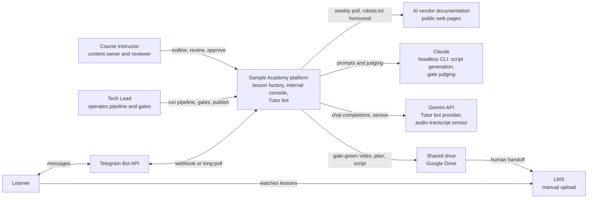
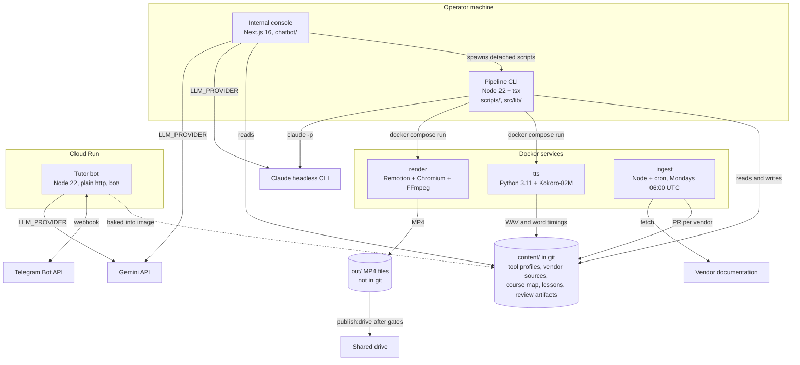
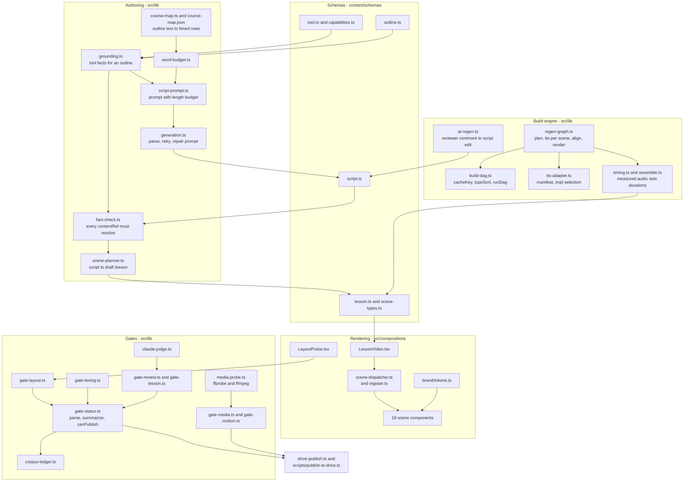
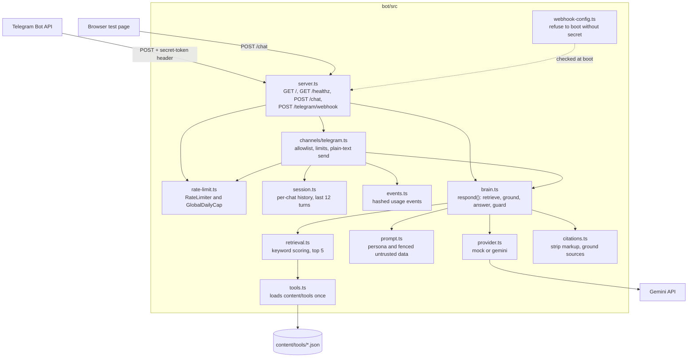
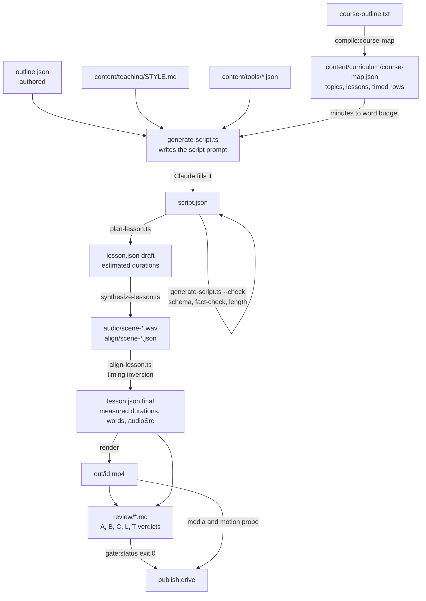
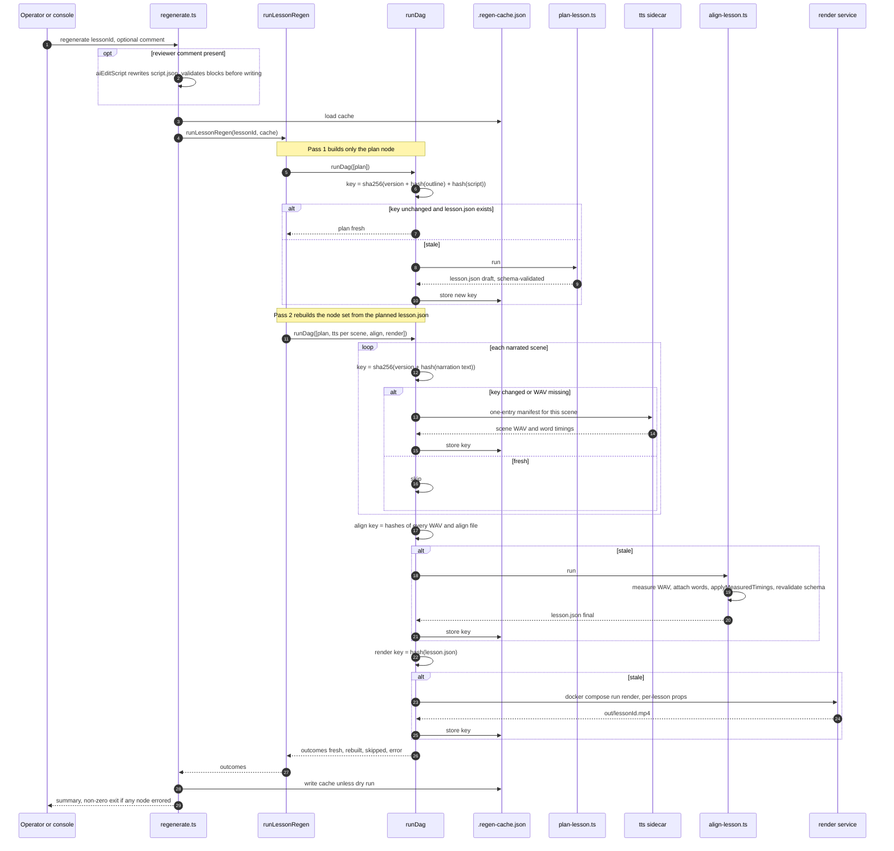
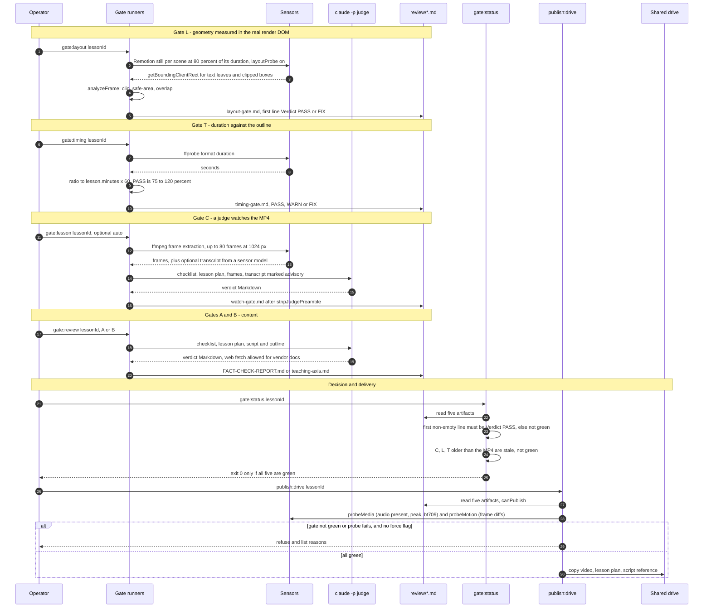

# Architecture

This document describes how the platform is put together, from the outside in: who and what it
talks to (context), what runs where (containers), how the code is organised inside the two
services that carry the most logic (components), and two end-to-end sequences (the regeneration
DAG and the gate flow to publish).

Every box other than an external service maps to a directory or file in this repository, and each
section links to the code it describes. Diagrams follow the C4 levels but are drawn as Mermaid flowcharts rather than
with Mermaid's C4 syntax, which Mermaid labels experimental.

The design decisions behind the shapes you see here are recorded as ADRs in
[`decisions/INDEX.md`](decisions/INDEX.md). This is a sanitized public copy of a private project;
see the "About this repository" box in the [README](../README.md).

Contents: [1 Context](#1-system-context) | [2 Containers](#2-containers) |
[3 Components](#3-components) | [4 Artifact lineage](#4-artifact-lineage-of-one-lesson) |
[5 Regeneration DAG](#5-sequence-the-regeneration-dag) | [6 Gate flow](#6-sequence-the-gate-flow-to-publish) |
[7 Trust boundaries](#7-trust-boundaries-and-failure-semantics)

---

## 1. System context

The platform turns a course outline into narrated video lessons, keeps the tool facts those
lessons teach current, and answers learner questions from the same curated facts. People interact
with it in three ways: the Instructor supplies and reviews content, the Tech Lead operates the
pipeline and the gates, and learners chat with the Tutor bot and watch the finished lessons in an
LMS.

Two boundaries are worth naming up front:

- **Video never enters git.** Finished MP4s go to a shared drive through
  [`scripts/publish-to-drive.ts`](../scripts/publish-to-drive.ts), and only after the gates pass.
  Upload from there to the LMS is a manual step; this repository does not automate it.
- **The public-facing service is deliberately small.** Only the Tutor bot ([`bot/`](../bot/))
  is designed to be deployed to the internet. The renderer, the gates, and the console run on the
  operator's machine.

## 2. Containers

| Container | Runtime | Responsibility | Code |
|---|---|---|---|
| Content data layer | JSON and Markdown in git | 14 tool profiles, 12 vendor source lists, the course map, per-lesson data and review artifacts, all validated by Zod schemas | [`content/`](../content/), [`content/schemas/`](../content/schemas/) |
| Pipeline CLI | Node 22 with `tsx` | Script prompts, fact-check, scene planning, TTS orchestration, alignment, regeneration DAG, all gates, publish, ingest | [`scripts/`](../scripts/), [`src/lib/`](../src/lib/) |
| Renderer | Remotion 4 in Node 22 with Chromium and FFmpeg | The `LessonVideo` composition and the scene components; renders 1920x1080 at 30 fps | [`src/compositions/`](../src/compositions/), [`docker/Dockerfile.render`](../docker/Dockerfile.render), [`scripts/render-lesson.ts`](../scripts/render-lesson.ts) |
| TTS sidecar | Python 3.11 slim, CPU-only PyTorch | One WAV and one word-timing file per scene from a batch manifest | [`docker/tts/synthesize.py`](../docker/tts/synthesize.py), [`docker/Dockerfile.tts`](../docker/Dockerfile.tts) |
| Ingestion job | Node with cron | Polls vendor pages, extracts fields, diffs against tool profiles, opens one PR per vendor | [`scripts/ingest.ts`](../scripts/ingest.ts), [`scripts/ingest/`](../scripts/ingest/), [`docker/crontab.ingest`](../docker/crontab.ingest) |
| Internal console | Next.js 16 App Router, 12 API routes, 10 pages | Tool library and comparison, Tutor chat, lesson directory with live gate badges, generate and regenerate controls, ingestion status | [`chatbot/`](../chatbot/) |
| Tutor bot | Node 22, `node:http`, no framework | Learner-facing Q and A over Telegram and a web test page | [`bot/`](../bot/), [`bot/Dockerfile`](../bot/Dockerfile), [`bot/cloudbuild.yaml`](../bot/cloudbuild.yaml) |

Compose services are defined in [`docker-compose.yml`](../docker-compose.yml) (render, ingest, tts,
dev) and [`docker-compose.chatbot.yml`](../docker-compose.chatbot.yml) (console). The TTS leg also
has a host-Python escape hatch (`TTS_NATIVE=1`) documented in
[`src/lib/tts-adapter.ts`](../src/lib/tts-adapter.ts). See
[ADR-005](decisions/005-container-first-render-and-tts-sidecars.md).

## 3. Components

### 3a. Lesson factory (`src/lib`, `content/schemas`, `src/compositions`)

Arrows point in the direction of data flow or invocation.

How to read it:

- **Schemas are the spine.** Outline, script, lesson and tool data are all Zod-validated at every
  boundary. `LessonSchema` checks each scene's `content` against the schema for its `type` and
  enforces a contiguous timeline ([`content/schemas/lesson.ts`](../content/schemas/lesson.ts)).
- **Authoring** produces a grounded script. `grounding.ts` loads only the tool facts an outline
  references, `script-prompt.ts` embeds them plus the length budget, and `fact-check.ts` rejects any
  script whose `contentRefs` do not resolve to a real tool or capability record
  ([`src/lib/fact-check.ts`](../src/lib/fact-check.ts)).
- **The build engine** is a small content-hash DAG (131 lines in
  [`build-dag.ts`](../src/lib/build-dag.ts)) plus the graph that describes one lesson
  ([`regen-graph.ts`](../src/lib/regen-graph.ts)). Timing inversion lives in
  [`timing.ts`](../src/lib/timing.ts): measured audio length replaces estimated durations.
- **Rendering** is data-driven. `LessonVideo` lays scenes out on a `<Series>` and dispatches each one
  through a registry ([`scene-dispatcher.ts`](../src/lib/scene-dispatcher.ts)); all 18 scene types are
  registered by [`register.ts`](../src/compositions/lesson-scenes/register.ts) and a test asserts
  the count.
- **Gates** are pure functions plus thin scripts. Sensors (DOM probe, ffprobe, frame diff) feed
  pure evaluators; LLM judges write Markdown whose first line is `Verdict: PASS|FIX`;
  `gate-status.ts` reads those files and decides whether publish is allowed.

### 3b. Tutor bot (`bot/src`)

The brain is one function, `respond(history, firstTurn, deps)`, shared by every channel. It
retrieves tool profiles by keyword, builds a system prompt that fences the retrieved data as
untrusted, calls a provider (`mock` for tests, `gemini` in the pilot), strips any source markup
the model emitted, and derives the `Sources:` footer from the retrieved tools the answer actually
names. Sources come from the retrieved set, never from model text, so a fabricated source cannot
reach the learner ([`bot/src/citations.ts`](../bot/src/citations.ts), covered by
[`bot/test/brain.test.ts`](../bot/test/brain.test.ts)). See
[ADR-006](decisions/006-standalone-tutor-bot-citation-guard.md).

### 3c. Internal console (`chatbot/`)

The console is a conventional Next.js App Router application, so it gets a table rather than a diagram.

| Concern | Where | Notes |
|---|---|---|
| Operator authorization | [`chatbot/src/lib/operator-auth.ts`](../chatbot/src/lib/operator-auth.ts) | Deny-by-default on write routes. Timing-safe `x-operator-token` check. A dev bypass exists but is ignored when `NODE_ENV=production`. |
| Rate limits, idempotency | [`rate-limit.ts`](../chatbot/src/lib/rate-limit.ts), [`idempotency.ts`](../chatbot/src/lib/idempotency.ts) | In-memory, per scope (`access`, `session`, `chat`, `operator`). Idempotency keys replay a cached response for ten minutes by default. |
| Long-running jobs | [`app/api/generate/route.ts`](../chatbot/src/app/api/generate/route.ts), [`generation-status.ts`](../chatbot/src/lib/generation-status.ts), [`process-tree.ts`](../chatbot/src/lib/process-tree.ts) | Generation is a detached background process with a status file, so navigating away does not kill it. Status is resolved from the file plus pid liveness plus draft freshness. Cancel kills the whole process tree and waits up to three seconds for exit before recording `canceled`. |
| Gate badges | [`lesson-gates.ts`](../chatbot/src/lib/lesson-gates.ts) | Mirrors the root parser, including the "verdict must be the first line" rule. |
| Tutor chat | [`app/api/chat/route.ts`](../chatbot/src/app/api/chat/route.ts), [`citations.ts`](../chatbot/src/lib/citations.ts), [`llm/`](../chatbot/src/lib/llm/) | Provider set is validated at startup and fails closed. Unset defaults to `mock` so an unconfigured deploy cannot bill a paid API. |
| Studio timeline | [`studio-timeline.ts`](../chatbot/src/lib/studio-timeline.ts), [`components/studio/`](../chatbot/src/components/studio/) | Four tracks (animation, voiceover, script, captions) on one time axis, derived from `lesson.json`. |

## 4. Artifact lineage of one lesson

A lesson is a directory of files under `content/lessons/<id>/`. Each arrow below is a command, and
each command is a node in the regeneration DAG or a gate.

## 5. Sequence: the regeneration DAG

`npm run regenerate -- <lessonId>` rebuilds only what is stale. The command is
[`scripts/regenerate.ts`](../scripts/regenerate.ts); the graph is built in
[`src/lib/regen-graph.ts`](../src/lib/regen-graph.ts) and executed by `runDag` in
[`src/lib/build-dag.ts`](../src/lib/build-dag.ts).

What the diagram shows:

1. **Cache keys are content, not time.** A node's key is the SHA-256 of its step version and the
   hashes of its inputs. Modification times are never consulted, because the artifacts live on
   container bind mounts where they are unreliable. Bumping a node's `version` forces a rebuild
   when the step's logic changes even though its inputs did not (the render node is at version 2).
2. **Per-scene granularity.** Each narrated scene is its own `tts:<sceneId>` node whose only input is
   that scene's narration text, so editing one scene resynthesizes one WAV. `align` and `render` then
   re-run because their inputs (the WAV and timing hashes, then `lesson.json`) changed.
3. **`align` hashes its inputs, not its output.** `align` rewrites `lesson.json` in place, so
   hashing `lesson.json` would make it perpetually stale. It hashes the WAVs and alignment files.
4. **Two passes.** Building all nodes up front hashed pre-plan narration, so a narration edit could
   ship stale audio, and scenes added or removed by `plan` left missing or orphaned nodes. Running
   `plan` first and building the rest from the fresh `lesson.json` removes both failure classes
   (regression tests in [`test/regen-graph.test.ts`](../test/regen-graph.test.ts)).
5. **Failure is contained and retryable.** If a node throws, its cache entry is deleted so the next
   run retries it, and every dependent is marked `skipped` instead of running on stale inputs.
6. **Script generation is deliberately not a node.** It is a Claude passthrough step. Instead,
   `script.json` is an *input* to `plan`, so editing it (by a person, or by the AI-edit step that
   applies a reviewer comment) makes `plan` stale and the change cascades.

`--dry` reports what would rebuild without running anything or writing the cache; on the sample
lesson `topic-1-lesson-1` it reports nine nodes that would rebuild, because the audio artifacts are
not part of this public copy.

## 6. Sequence: the gate flow to publish

A lesson may be published only when all five artifact gates are green, and the encoded MP4 itself
passes two probe gates at the publish boundary. Sensors are deterministic. The judge is an LLM,
and it only ever writes a file that a deterministic parser then reads.

Design notes:

- **Fail-closed verdict parsing.** [`parseGateState`](../src/lib/gate-status.ts) accepts a gate only if
  the *first non-empty line* is `Verdict: PASS`. A missing file is `missing`, a present file with no
  parseable verdict is `fix`, and `WARN` is deliberately not green. This rule came from an
  independent-model review finding recorded in the code; judges that wrap their output in preamble
  are normalised at write time by `stripJudgePreamble` in
  [`claude-judge.ts`](../src/lib/claude-judge.ts) so the parser can stay strict.
- **The judge is never the sensor.** Gate C's transcript comes from a cheaper sensor model and is
  labelled advisory in the judge prompt; the judge must check any claim against the frames and the
  lesson plan ([`gate-lesson.ts`](../src/lib/gate-lesson.ts)).
- **Stale artifacts do not count.** Gates C, L and T judge the *rendered* MP4. If their artifact is
  older than the MP4, `gate:status` reports it stale, which is not green
  ([`gate-status.ts`](../src/lib/gate-status.ts), tested in
  [`test/gate-status.test.ts`](../test/gate-status.test.ts)). The publish script re-reads the same five
  artifacts but does not pass file times, so run `gate:status` first; this asymmetry is listed under
  known limitations in the README.
- **Two gates exist only because the other gates missed real defects.** The motion gate exists
  because a render shipped as a slideshow that passed every artifact gate; the geometry gate exists
  because the watch gate waved through overlapping text. Thresholds are documented with their
  calibration in [`.planning/MOTION-CONTRACT.md`](../.planning/MOTION-CONTRACT.md) and
  [`wiki/concepts/layout-integrity-gate.md`](../wiki/concepts/layout-integrity-gate.md).
- **The ledger makes batch claims countable.** `npm run corpus:ledger` enumerates every lesson from
  the filesystem, prints one row per lesson and an `N/N` line, and exits non-zero unless all are
  green ([`scripts/corpus-ledger.ts`](../scripts/corpus-ledger.ts)). On this public copy it prints
  `CORPUS: 0/2 lessons fully green`, because review bundles and renders are not included.

See [ADR-004](decisions/004-deterministic-sensors-llm-judge-gates.md).

## 7. Trust boundaries and failure semantics

| Boundary | Rule | Evidence |
|---|---|---|
| Untrusted retrieved text inside prompts | Retrieved tool data sits between explicit BEGIN and END markers and the prompt tells the model to treat it as data, not instructions | [`bot/src/prompt.ts`](../bot/src/prompt.ts) |
| Webhook caller | Fixed path; authorization is only the `X-Telegram-Bot-Api-Secret-Token` header, compared in constant time; no configured secret means no valid caller; the process refuses to boot in webhook mode with a token and no secret | [`bot/src/server.ts`](../bot/src/server.ts), [`bot/src/webhook-config.ts`](../bot/src/webhook-config.ts), [`bot/test/server.test.ts`](../bot/test/server.test.ts) |
| Operator actions in the console | Deny by default; token header compared in constant time; lesson and scene ids are pattern-checked before any process is spawned | [`operator-auth.ts`](../chatbot/src/lib/operator-auth.ts), [`regen-trigger.ts`](../chatbot/src/lib/regen-trigger.ts) |
| Paid providers | Unset provider defaults to `mock`; choosing a paid provider without its key throws at startup | [`chatbot/src/lib/config.ts`](../chatbot/src/lib/config.ts), [`bot/src/provider.ts`](../bot/src/provider.ts) |
| Scraping | Per-source `reference-only` mode is skipped by the scraper; other sources are checked against `robots.txt`; extracted values are validated against the tool schema before any write, and unknown keys are never merged | [`scripts/ingest/scraper.ts`](../scripts/ingest/scraper.ts), [`scripts/ingest/differ.ts`](../scripts/ingest/differ.ts) |
| Ingestion staleness signal | When every source of a vendor is `reference-only`, a scheduled run logs that automatic refresh is inactive for that vendor instead of reporting "fresh" | [`scripts/ingest.ts`](../scripts/ingest.ts) |
| Font loading in renders | A font that fails to load cancels the render; it never falls back silently | [`test/font-loader.test.ts`](../test/font-loader.test.ts) |
| Process hangs | Render batches have a per-lesson watchdog and frame timeout; the console's cancel kills the whole process tree and waits up to three seconds for it to exit before recording `canceled` | [`scripts/render-lesson.ts`](../scripts/render-lesson.ts), [`process-tree.ts`](../chatbot/src/lib/process-tree.ts) |
