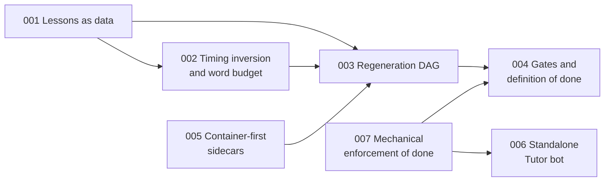

# Architecture decision records

Seven decisions that shape this codebase. Each record follows a MADR-style structure (context, decision,
consequences, alternatives considered) and ends with an evidence list of the files and tests behind it.
Consequences include costs and known gaps, not only benefits.

The records were written from the code and documents in this repository. Where a claim rests on a private
corpus that is not included in this public copy, the record says so. "First appears" dates come from the
commit history, whose original timestamps are preserved.

| # | Decision | Status | First appears | One-line summary |
|---|---|---|---|---|
| [001](001-lessons-as-data-scene-dispatcher.md) | Lessons are validated data; scenes dispatch by type from a registry | Accepted | 2026-05-13 | A lesson is a Zod-validated JSON document over a closed set of 18 scene types, so content changes never require React and bad lessons fail before a render |
| [002](002-timing-inversion-and-word-budget.md) | Narration audio drives scene duration; script length is budgeted at three layers | Accepted | 2026-05-23 (timing), 2026-06-11 (budget) | Measured audio sets on-screen time; because words are then video length, the word budget is enforced in the prompt, in a seconds-long pre-flight check, and in a post-render gate |
| [003](003-content-hashed-regeneration-dag.md) | A small content-hashed DAG rebuilds only what changed | Accepted | 2026-05-23 | 131 lines of orchestration hash step version and input content, rebuild per scene, and build the node set in two passes to avoid stale audio |
| [004](004-deterministic-sensors-llm-judge-gates.md) | Deterministic sensors plus an LLM judge, with a fail-closed definition of done | Accepted | 2026-06-08 to 2026-07-15 | Five verdict files (A, B, C, L, T) plus media and motion probes; the parser only accepts a PASS on the first line; stale verdicts do not count; batch claims are printed as N/N |
| [005](005-container-first-render-and-tts-sidecars.md) | Container-first rendering; speech synthesis as a Python sidecar | Accepted | 2026-05-13 (render), 2026-05-23 (speech) | Docker images for render, speech and ingestion; licence-checked local voice models; POSIX paths across the host boundary; a native escape hatch |
| [006](006-standalone-tutor-bot-citation-guard.md) | A standalone, dependency-free Tutor bot whose sources are grounded by construction | Accepted | 2026-06-09 | A 908-line service with a channel-agnostic brain, a source footer computed from retrieved data, and a hardened webhook, rate limits and container |
| [007](007-mechanically-enforced-done.md) | "Done" is enforced by a stop hook, CI and a completion contract, with a second model as reviewer | Accepted | 2026-05-23 (hook, CI), 2026-06-22 (contract) | Typecheck, lint and tests must pass on the changed slice before an AI session can end; completion needs artifacts and an independent review |

## How the decisions fit together

- 001 defines the artifact that everything else transforms.
- 002 makes that artifact's length a function of its narration, which is why 003 has to be per scene and why
  004 includes a timing gate.
- 003 relies on 005 for the expensive steps it caches.
- 004 decides when the output is good enough to ship, and 007 applies the same "artifacts, not assertions"
  rule to the code itself.
- 006 reuses the same curated tool data as 001 but shares no code with the rest of the pipeline.

## Conventions

- Decisions are recorded after the fact from evidence in the repository; none is invented to fit a
  narrative. Earlier informal decision logs remain in
  [`wiki/concepts/architecture-decisions.md`](../../wiki/concepts/architecture-decisions.md) and
  [`.planning/DECISIONS.md`](../../.planning/DECISIONS.md).
- A record is superseded by a new record, not edited away.
- The overall system view these decisions fit into is in [`../ARCHITECTURE.md`](../ARCHITECTURE.md).
